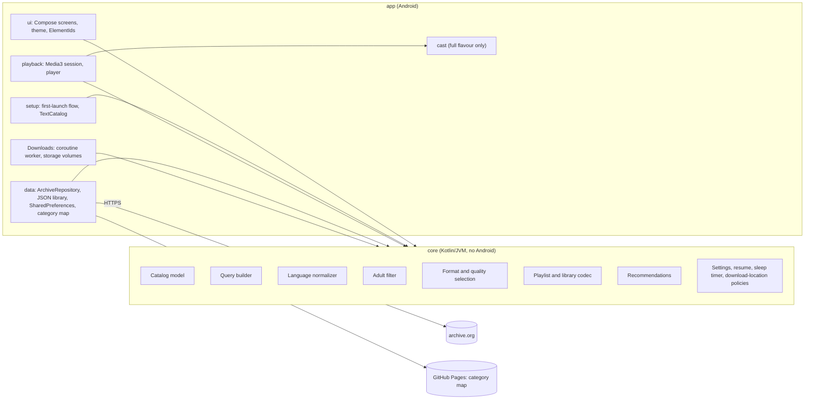
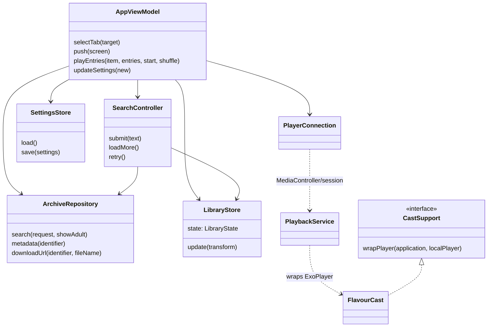
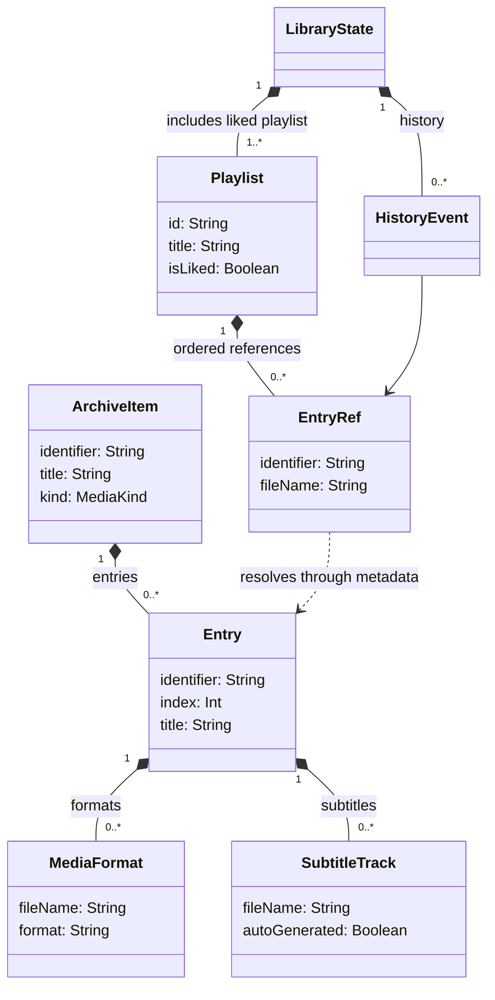
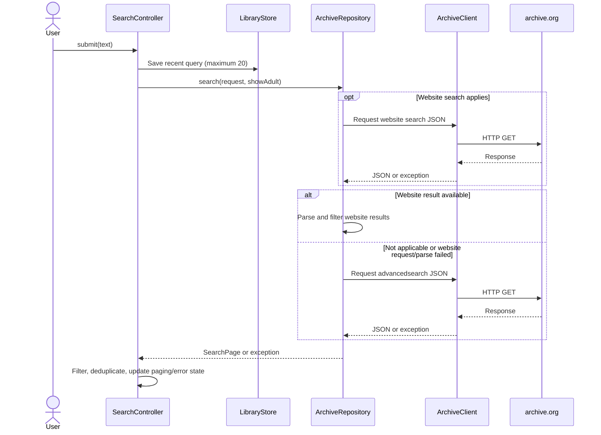
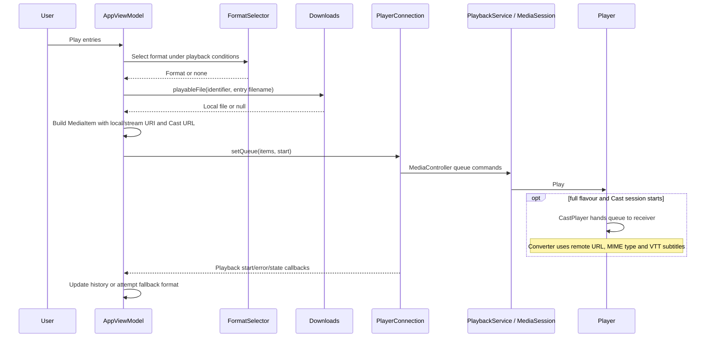
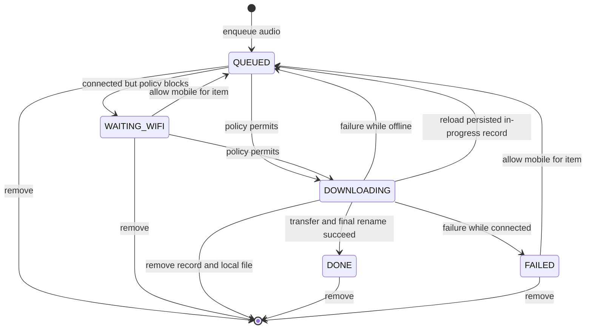
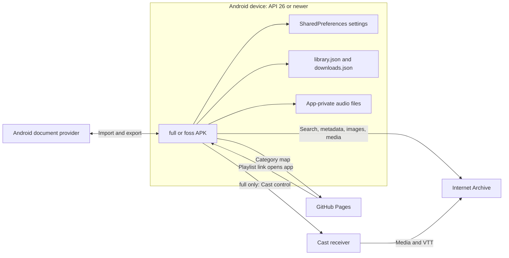

# Architecture and UML

Implementation snapshot: 15 November 2026. This document replaces the early proposal and describes the checked-in sources. Class, sequence and state views use UML-style Mermaid notation; component and deployment views use Mermaid flowcharts. See the [documentation index](README.md).

## Modules and boundaries

`core` takes plain inputs and returns decisions, so it is tested on the JVM without an emulator. There are two Gradle modules, `app` and `core`; the boxes inside them are responsibilities, not separate modules. `AppViewModel` is a substantial coordinator for setup, navigation, library operations, playback and downloads. Stores and controllers also expose Compose state. Persistence uses JSON files and SharedPreferences, not Room or DataStore. Adult keywords are bundled assets; only the category map is refreshed by `ArchiveRepository`.

## Flavours

| Source set | Contents |
|---|---|
| `app/src/main` | Everything shared; playback through an interface that does not reference Cast |
| `app/src/full` | Cast integration (Media3 Cast, `MediaRouteButton`, options provider) |
| `app/src/foss` | No-op Cast bindings; no Google dependencies |

## Runtime classes

`FlavourCast` is supplied by exactly one source set. The full implementation wraps ExoPlayer in Media3 CastPlayer with RemoteCastPlayer; foss returns the local player. `:app:verifyFossDependencies` rejects forbidden Google/Cast/MediaRouter dependencies.

Sources: [AppViewModel](../app/src/main/java/com/jutlandiatech/archiveplayer/AppViewModel.kt), [SearchController](../app/src/main/java/com/jutlandiatech/archiveplayer/ui/SearchController.kt), [CastSupport](../app/src/main/java/com/jutlandiatech/archiveplayer/cast/CastSupport.kt), [full implementation](../app/src/full/java/com/jutlandiatech/archiveplayer/cast/FlavourCast.kt), [foss implementation](../app/src/foss/java/com/jutlandiatech/archiveplayer/cast/FlavourCast.kt).

## Catalog and library model

Only selected fields are shown. An item has entries, each with alternative media formats. Playlists store references rather than copied media. Entry identity differs from the selected format filename: `DownloadRecord.fileName` identifies the entry; `formatFile` identifies the stored format.

Sources: [catalog model](../core/src/main/kotlin/com/jutlandiatech/archiveplayer/core/catalog/Model.kt), [playlist model and codecs](../core/src/main/kotlin/com/jutlandiatech/archiveplayer/core/playlist/Playlists.kt), [LibraryState](../app/src/main/java/com/jutlandiatech/archiveplayer/data/LibraryStore.kt).

## Search sequence

Search uses 50 rows per page and distinguishes first-page and paging errors. A new request cancels the old coroutine job. `ArchiveClient` retries HTTP 429/5xx up to three total attempts, using integer-second Retry-After or exponential delays. This policy applies to that client, not every media/download network path.

Sources: [repository](../app/src/main/java/com/jutlandiatech/archiveplayer/data/ArchiveRepository.kt), [network client](../core/src/main/kotlin/com/jutlandiatech/archiveplayer/core/net/ArchiveClient.kt).

## Playback sequence

The service owns player/session lifetime; the view model coordinates metadata, fallback formats and history. History is capped at 500 events; position saves occur on pause and periodically while playing unless history is paused. Cast streams the remote URL even when the phone has a local file. Physical receiver handover still needs hardware validation.

Sources: [PlayerConnection](../app/src/main/java/com/jutlandiatech/archiveplayer/playback/PlayerConnection.kt), [PlaybackService](../app/src/main/java/com/jutlandiatech/archiveplayer/playback/PlaybackService.kt).

## Download state machine

The sequential worker polls blocked pending work every three seconds. Offline entries can remain `QUEUED`. Transfers use `.part` files and Range requests, appending only after HTTP 206. Removal deletes the record/local file; it does not explicitly cancel an active blocking HTTP transfer. Moving finished downloads copies and verifies file length before updating location and deleting the source; this is not checksum verification.

Sources: [Downloads](../app/src/main/java/com/jutlandiatech/archiveplayer/data/Downloads.kt), [storage policies](../core/src/main/kotlin/com/jutlandiatech/archiveplayer/core/download/Downloads.kt).

## Deployment

No ArchivePlayer application backend is implemented here. GitHub Pages serves static content and the share page through [pages.yml](../.github/workflows/pages.yml). App Link verification depends on hosted association data and release signing; see [App Links](APP_LINKS.md).

## Maintaining the diagrams

Update the relevant view when changing class ownership, storage, service boundaries or flows. Keep requirements in [SPECIFICATION.md](../SPECIFICATION.md), proposed changes in [proposals](proposals/2026-11-13-fullscreen-search-cast.md), and measured results in [TDD_EVIDENCE.md](../TDD_EVIDENCE.md). A diagram does not establish acceptance-test success.
