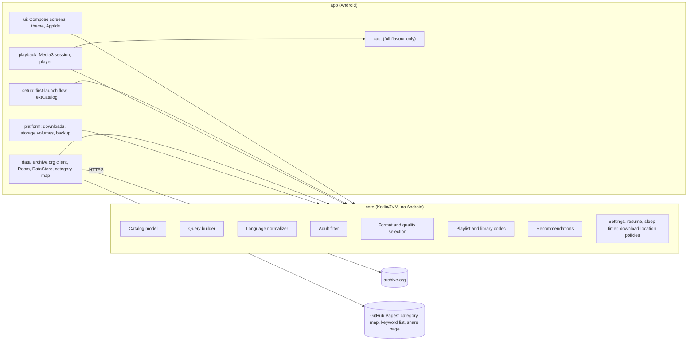
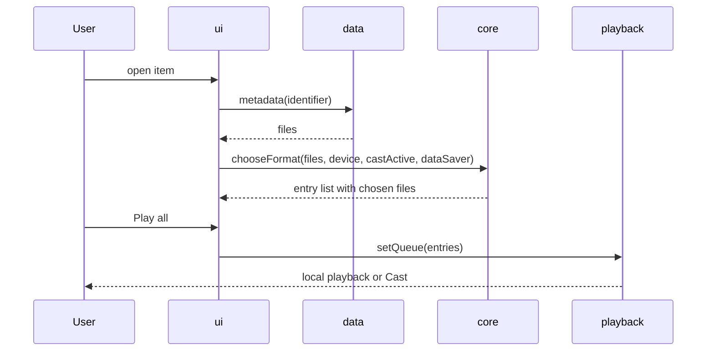

# Application architecture (proposed)

Proposed alongside specification v0.2; becomes binding with the implementation gate and is updated as code lands.

## Modules and boundaries

`core` takes plain inputs (parsed responses, settings, timestamps) and returns decisions, so it is tested on the JVM without an emulator. Android adapters stay thin.

## Flavours

| Source set | Contents |
|---|---|
| `app/src/main` | Everything shared; playback through an interface that does not reference Cast |
| `app/src/full` | Cast integration (Media3 Cast, `MediaRouteButton`, options provider) |
| `app/src/foss` | No-op Cast bindings; no Google dependencies |

## Main flows

